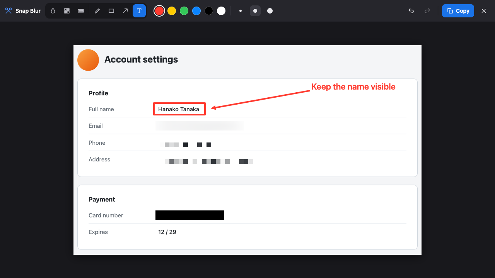
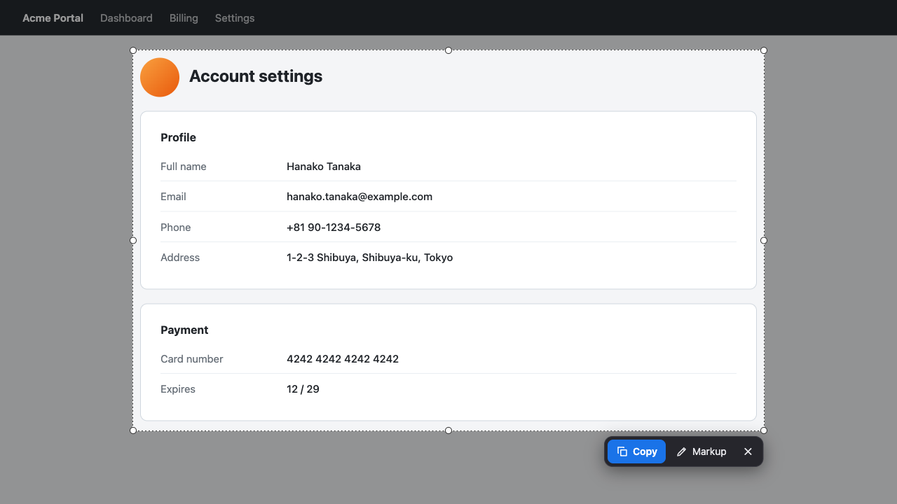
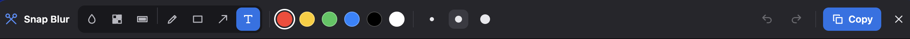
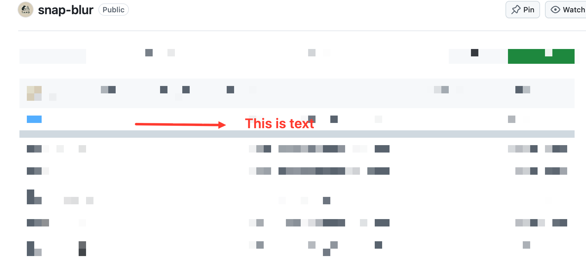

<p align="center">
  
</p>

<h1 align="center">Snap Blur</h1>

<p align="center">
  Screenshot the current tab, hide personal information, add notes, and copy.<br>
  A Chrome / Edge extension that <b>never saves files</b>.
</p>

<p align="center">
  
</p>

## Why

Sharing a screenshot in Slack, a ticket, or a bug report often shows more than you want:
emails, phone numbers, addresses, tokens, customer data. Snap Blur lets you hide that
**before** the image leaves your screen. The image goes only to your clipboard.
Nothing is saved to disk, and nothing is uploaded.

## Features

- **Select an area in the page.** It works like Edge's built-in Screenshot: the page
  freezes, you drag an area, and you resize it with handles.
- **Hide information:** Blur, Pixelate, or Redact (solid black box).
- **Annotate:** Pen, Rectangle, Arrow, and Text, with 6 colors and 3 sizes.
- **Undo / Redo** for every edit.
- **Copy to clipboard** with one key, then paste anywhere.
- **Private by design:** no `downloads`, no `storage`, no host permissions, and no
  network requests. The image only lives in memory until you copy or cancel.
- **Works on strict pages:** the UI lives in a closed Shadow DOM and is built without
  `innerHTML`, so a page's CSP or Trusted Types do not block it.

## How it works

**1. Select an area.** Press `Alt+Shift+S` or click the toolbar icon.



- Drag to select. Drag the handles to resize. Drag inside the area to move it.
- **Whole screen** selects everything.
- **Copy** (`Enter`) copies the area right away.
- **Markup** opens the editor so you can hide or annotate first.

**2. Hide and annotate**, then **Copy**.



Hide tools show a **Strength** slider. Draw tools show the colors and sizes.

Real-world result, pasted from the clipboard:



## Install

The extension is not in the Chrome Web Store yet. Load it unpacked:

1. Clone or download this repository.
   ```bash
   git clone https://github.com/nguyenduyta/snap-blur.git
   ```
2. Open `chrome://extensions` (Chrome) or `edge://extensions` (Edge).
3. Turn on **Developer mode**.
4. Click **Load unpacked** and select the `snap-blur` folder.
5. Optional: pin the scissors icon to the toolbar.

To update, run `git pull`, then click the reload icon on the extension card.

## Keyboard shortcuts

**Select step**

| Key | Action |
|---|---|
| `Alt+Shift+S` | Start a capture (change it at `chrome://extensions/shortcuts` or `edge://extensions/shortcuts`) |
| `Enter` / `Ctrl/Cmd+C` | Copy the selected area |
| `Esc` | Clear the selection, press again to cancel |

**Markup step**

| Key | Tool |
|---|---|
| `B` | Blur |
| `P` | Pixelate |
| `K` | Redact (black box) |
| `D` | Pen |
| `R` | Rectangle |
| `A` | Arrow |
| `T` | Text |

| Key | Action |
|---|---|
| `Ctrl/Cmd+Z` | Undo |
| `Ctrl/Cmd+Shift+Z`, `Ctrl+Y` | Redo |
| `Enter` / `Ctrl/Cmd+C` | Copy and close |
| `Esc` | Cancel the current drag, then close |

**Text tool:** click on the image, type, then press `Enter` to place the text.
`Shift+Enter` starts a new line. `Esc` discards the text. IME input (Vietnamese,
Japanese, and others) works: the `Enter` that confirms a composition does not place the text.

## Permissions

| Permission | Why |
|---|---|
| `activeTab` | Capture the visible tab, only after you click the icon or press the shortcut |
| `scripting` | Show the selection and markup overlay in that tab |
| `clipboardWrite` | Copy the final image to the clipboard |

## Limitations

- Captures the visible area only. Full-page scroll capture is not supported.
- Browser pages (`chrome://`, `edge://`, Web Store, built-in PDF viewer) cannot be captured.
  The icon shows a red `!`.
- Copy needs a secure page (`https://` or `localhost`). On plain `http://` pages the
  browser blocks clipboard access.
- A weak blur on large text can sometimes be reversed. For passwords, tokens, and card
  numbers, use **Redact**.

## Project structure

```
manifest.json   Manifest V3, permissions, shortcut
background.js   Captures the tab and injects the overlay
content.js      Overlay: area selection, markup editor, clipboard copy
icons/          icon.svg (source) and PNG sizes 16 / 48 / 128
docs/           README images
```

No build step and no dependencies. Edit the files and reload the extension.
